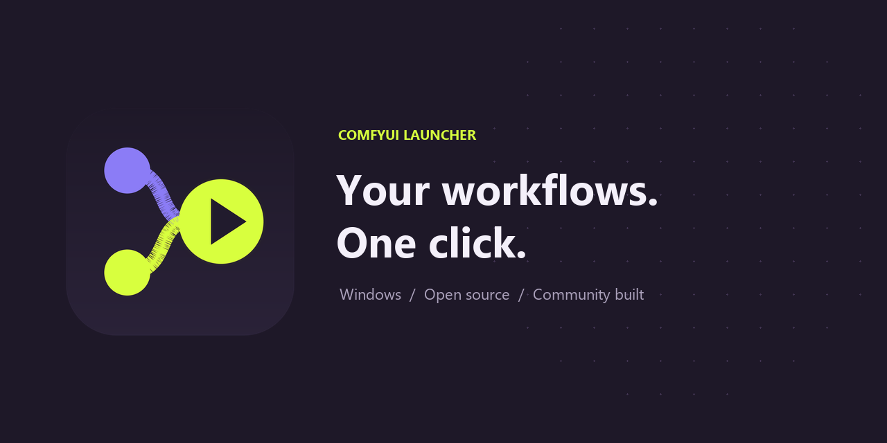

<p align="center"></p>

# ComfyUI Launcher

مشغّل مجتمعي غير رسمي لنظام Windows يفتح **نسخة ComfyUI المثبتة لديك** بنقرة واحدة،
بواجهة عربية وإنجليزية وأيقونة في شريط النظام.

[تحميل أحدث إصدار](https://github.com/AlBaraa-AlHajri/ComfyUI-Launcher/releases/latest)
· [English](README.md) · [قرارات التصميم](DECISIONS.md)



<p align="center"></p>

## الميزات

- نافذة بداية داكنة تعرض الحالة والوقت المنقضي ومؤشر التقدم.
- تشغيل بيئة Python أو النسخة المحمولة دون نافذة أوامر.
- انتظار جاهزية الخادم ثم فتح Chrome كنافذة تطبيق بحجم 1600×950.
- استخدام Edge ثم المتصفح الافتراضي إذا لم يتوفر Chrome.
- منع تكرار الخادم، والتركيز على نافذة التطبيق عند التشغيل مرة ثانية.
- قائمة شريط النظام: فتح، إعادة تشغيل، إيقاف، السجل، مجلد البرنامج والنتائج، الإعدادات، حول، خروج.
- إيقاف تعاوني ثم تنظيف العمليات الفرعية عند تجاوز المهلة، مع حماية Windows Job Object.
- دعم مسارات عربية ومسافات وسجلات UTF-8؛ تصميم أيقونة أصلي لا يستخدم شعار Comfy Org.

## المتطلبات والتشغيل الأول

تحتاج Windows 10 أو 11 بنظام x64 ونسخة ComfyUI تعمل بالفعل مع بيئة venv أو Python
المحمول. المشغّل يتضمن بيئته الخاصة، لكنه **لا يتضمن ComfyUI أو النماذج أو تعريفات
البطاقة أو PyTorch، ولا يعدّل بيئة ComfyUI**.

1. نزّل ملف ZIP وملف `SHA256SUMS.txt` من [الإصدارات](https://github.com/AlBaraa-AlHajri/ComfyUI-Launcher/releases).
2. فك ضغط المجلد كاملاً في مكان دائم. يجب أن يبقى مجلد `_internal` بجانب الملف التنفيذي.
3. افتح `ComfyUI-Launcher.exe`. يحاول اكتشاف التثبيت تلقائياً؛ عند عدم العثور عليه استخدم
   زر الاستعراض لاختيار المجلد الذي يحتوي `main.py` وملف `python.exe` الخاص ببيئته، ثم احفظ.
4. الإعدادات الافتراضية: العربية، المنفذ 8188، خيار `--lowvram`، مهلة 180 ثانية، وChrome
   في وضع التطبيق. بعد الجاهزية تختفي النافذة إلى شريط النظام.
5. لإنشاء اختصار سطح المكتب وقائمة ابدأ، شغّل `Create-Shortcut.ps1` المرفق باستخدام
   PowerShell. في نسخة المصدر استخدم `scripts/create_shortcut.ps1`.

قارن نتيجة الأمر التالي مع ملف البصمة:

```powershell
Get-FileHash -Algorithm SHA256 .\ComfyUI-Launcher-v1.0.0-win64.zip
```

إذا كان ComfyUI يعمل مسبقاً، يستخدمه المشغّل دون امتلاكه. الإيقاف وإعادة التشغيل يعرضان
توضيحاً؛ أدر ذلك الخادم من نافذته الأصلية. لإدارته من المشغّل، أوقف الخادم القديم ثم أغلق
المشغّل وافتحه من جديد.

## الإعدادات

افتح الإعدادات من شريط النظام أو باستخدام `ComfyUI-Launcher.exe --settings`. يمكنك
تغيير المسارات والمنفذ والمتصفح واللغة والمهلة ووضع التطبيق والفتح التلقائي والإخفاء.
اختر وضع ذاكرة واحداً فقط. مثال لوسائط إضافية بمسار يحتوي مسافات:

```text
--output-directory "E:\My Outputs\صور" --preview-method auto
```

يتحكم المشغّل في `--port` و`--disable-auto-launch` ويلغي أثر `--auto-launch` القديم.
خيار `--listen` يسمح بالوصول من الشبكة؛ أي عنوان مخصص يجب أن يتضمن `127.0.0.1` أو
`0.0.0.0` لفحص الجاهزية. تُطبق اللغة فوراً، وتُطبق إعدادات الخادم والمتصفح عند التشغيل
التالي أو إعادة التشغيل. يبقى عنوان الخادم الحالي ثابتاً بعد تعديل المنفذ المحفوظ.

ملف الإعدادات: `%APPDATA%\ComfyUI-Launcher\config.json`. يشمل مفاتيح المسارات،
`extra_args`، `port`، `browser`، `app_mode`، `startup_timeout`، `open_browser_on_start`،
`minimize_to_tray`، `language` و`schema_version`. سجلات UTF-8 وملف المتصفح المستقل
موجودة في المجلد نفسه. وضع التطبيق لا يرث جلسات تسجيل الدخول وإضافات Chrome المعتادة.

## البناء والاختبار

ثبّت Git وPython **3.11 x64** ثم نفّذ:

```powershell
git clone https://github.com/AlBaraa-AlHajri/ComfyUI-Launcher.git
cd ComfyUI-Launcher
.\scripts\build.bat
.\scripts\run_from_source.bat
```

ينشئ البرنامج بيئة `.build-venv`، ويثبّت المتطلبات بإصدارات محددة، ويولّد الأيقونات،
ثم يشغّل Ruff وpytest ويبني الملف في `dist/ComfyUI-Launcher/ComfyUI-Launcher.exe`.
إذا لم يتوفر أمر `py`، يجب أن يشير أمر `python` إلى الإصدار 3.11.

```powershell
.\.build-venv\Scripts\python.exe -m ruff check .
.\.build-venv\Scripts\python.exe -m pytest -q
$test = Start-Process .\dist\ComfyUI-Launcher\ComfyUI-Launcher.exe -ArgumentList '--self-test' -WindowStyle Hidden -Wait -PassThru
$test.ExitCode
Get-Content "$env:APPDATA\ComfyUI-Launcher\self-test.json"
.\scripts\create_shortcut.ps1
```

وضع `--self-test` يفحص الإعدادات والمتصفحات والأيقونات وموارد الحزمة دون تشغيل خادم أو
متصفح. على جهاز بلا تثبيت ComfyUI يوضح أن الإعداد الأول مطلوب، ويفحص الحزمة مع ذلك.
يمكن تحديد تقرير آخر بخيار `--self-test-report`، أو عزل مجلد البيانات باختبار محلي
باستخدام متغير `COMFY_LAUNCHER_HOME`.

## حل المشاكل

- **Unknown publisher في SmartScreen:** الإصدار المجتمعي غير موقّع. تحقق من المصدر
  والبصمة. إذا وثقت بالتحميل، يتيح Windows خيار More info ثم Run anyway.
- **تحذير مضاد الفيروسات:** افحص الملف أو ابنِ المصدر محلياً وأبلغ الشركة عن الإنذار
  الخاطئ. لا تعطّل الحماية العامة.
- **المنفذ مستخدم:** يُستخدم خادم ComfyUI الموجود؛ إذا كان برنامجاً آخر يُعرض منفذ بديل.
- **Chrome غير موجود:** يُجرّب Edge ثم المتصفح الافتراضي؛ يمكنك تغيير الاختيار بالإعدادات.
- **فشل التشغيل:** استخدم نسخ الخطأ وفتح السجل وإعادة المحاولة. راجع المسار وPython
  والعقد المخصصة ومتطلبات ComfyUI. زد المهلة عند بطء التحميل.
- **تحذيرات CUDA أو PyTorch أو triton:** مصدرها بيئة ComfyUI. المشغّل يسجلها ولا يحدّث
  الحزم أو تعريفات البطاقة.
- **الإيقاف لا يغلق الخادم الموجود مسبقاً:** ذلك الخادم يتبع لنافذته الأصلية.
- **الأيقونة غير ظاهرة:** افحص قائمة الأيقونات المخفية. عند تعذّر إنشاء أيقونة تبقى
  نافذة الإدارة ظاهرة.
- **تلف الإعدادات:** احفظ إعدادات مصححة؛ تُحفظ النسخة القديمة باسم `config.invalid-*.json`.

السجلات في `%APPDATA%\ComfyUI-Launcher\logs`، باسم `launcher.log` و
`comfyui_YYYY-MM-DD.log`. راجع البيانات الخاصة قبل مشاركة السجلات علناً.

## النشر والترخيص

تعمل اختبارات Windows عند الدفع وطلبات الدمج. ينشئ وسم مثل `v1.0.0` إصدار ZIP وبصمة
SHA-256 عبر GitHub Actions بعد الاختبار والبناء. أوامر النشر في [PUBLISHING.md](PUBLISHING.md).
لصورة المشاركة ارفع `assets/social_preview.png` من إعدادات المستودع في GitHub، قسم
General ثم Social preview. مصدر الأيقونة `assets/icon.svg`، وتُولّد الملفات بأمر
`python tools/make_icon.py`.

هذا **مشروع مجتمعي غير رسمي وغير تابع لـ Comfy Org**. الكود والتصميم الأصلي تحت
[رخصة MIT](LICENSE).
